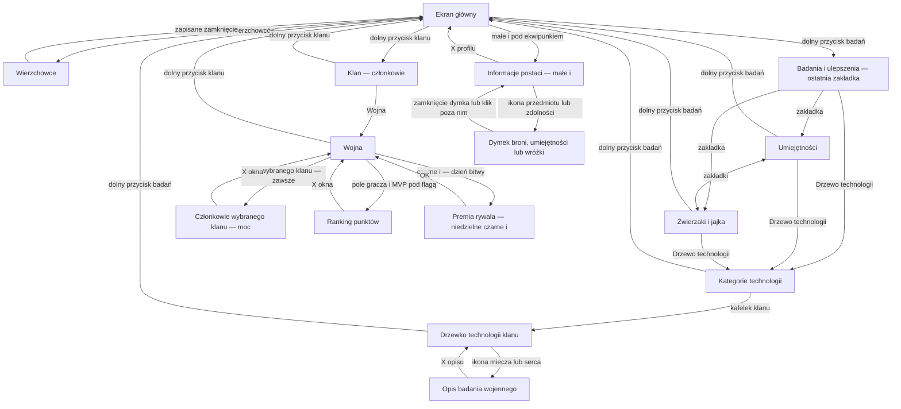
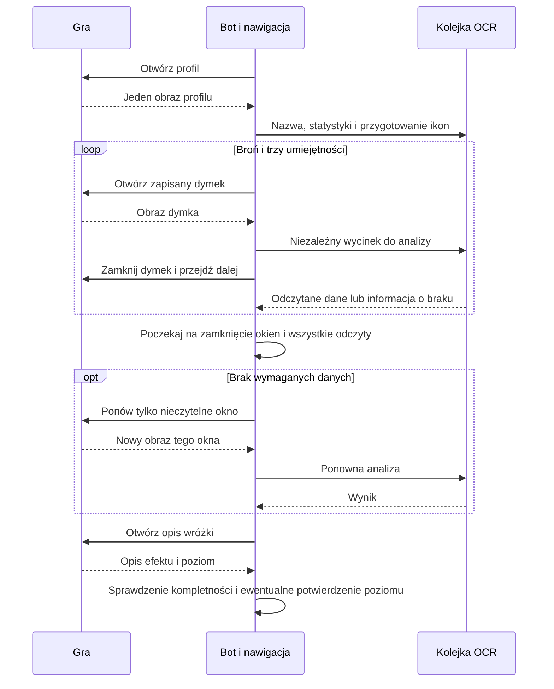

# Mapa ekranów i przejść Botysława

Stan: 4 listopada 2026. Źródła: nagranie użytkownika `Screen_Recording_20261104_124020_Forge Master.mp4` (2:38), wcześniejsze nagrania wojny i screeny oraz doprecyzowanie użytkownika dotyczące flag i MVP. Mapa obejmuje trasy skanera; rozszerzamy ją o kolejne zaobserwowane ekrany.

## Ekrany

Ważne rozróżnienia:

- Flaga klanu otwiera listę graczy z mocą również w tygodniu. Pole MVP poniżej otwiera ranking punktów. Rozdział tych dwóch akcji potwierdził użytkownik; wideo pokazuje właśnie kliknięcia MVP.
- Czarne `i` premii przeciwnika jest dostępne w dniu bitwy. Test listy w tygodniu przyjmuje równe bonusy obu stron.
- Po otwarciu badań gra może pamiętać umiejętności, zwierzaki albo technologię. Ten jeden wariant wymaga ustalenia aktywnej zakładki, zanim po raz pierwszy zbierzemy pola jej zawartości.
- X opisu badania wraca do drzewka, X listy klanu wraca do wojny, a dolne przyciski badań/klanu wracają do ekranu głównego. Współrzędne powrotu całej sekcji pochodzą z wejścia do tej sekcji.
- Zewnętrzne okno profilu konta z nickiem/ustawieniami, liga, rankingi technologii i nagrody wojenne widoczne na filmie nie są trasą skanera. Nie należy ich mylić z informacjami postaci otwieranymi małym `i`.

## Zasady wykonania

Źródłem prawdy dla używanych akcji jest `GameNavigationGraph.kt`. Zawiera dozwolone ekrany wejściowe i jednoznaczny cel każdej akcji. Konfiguracja telefonu przechowuje geometrię przycisku, a nie znaczenie kliknięcia. Moduły zasobów oraz badań/wojny korzystają z tej samej mapy.

1. Początek nowego skanu/konfiguracji: rozpoznanie aktualnego ekranu lub potwierdzony wewnętrzny powrót z innego modułu.
2. Zatwierdzenie pól: wszystkie widoczne pola jednego ekranu razem, w różnych kolorach. Zapis geometrii bez OCR liczb.
3. Udany gest: aktualizacja oczekiwanego ekranu według mapy. Po znanym przejściu bez ponownego szukania ekranu głównego.
4. Odczyt danych: zapisane obszary, kilka pól ze wspólnego obrazu, kontrola wymaganych wartości. Szukanie ikon na liście badań jest odczytem zawartości listy.
5. Błąd gestu, nieoczekiwana zawartość, ręczna ingerencja lub STOP: unieważnienie stanu; poprawa i ponowienie bieżącego etapu. Nie restart całej konfiguracji.

Zasoby mają pięć podglądów konfiguracji: główny (młotki i oba wejścia), wierzchowce (klucze, koszt, lista, zamknięcie), trzy dolne zakładki badań, pola umiejętności (bilety i koszt) oraz lista zwierzaków. Dolne zakładki zawsze ustawiamy osobno przed odczytem zawartości, nawet jeśli gra zapamiętała drzewko technologii. Po zatwierdzeniu zakładek skaner najpierw klika Umiejętności i dopiero potem proponuje bilety i koszt. Pozycja Drzewo technologii jest współdzielona z modułem walki. Przycisk już zatwierdzony na wcześniejszym podglądzie nie wymaga osobnego zaznaczenia przy przejściu.

## Przewijane badania

Zapisywana trasa zaczyna się na potwierdzonej górze listy. Zawiera wersję gestu, rozmiar obrazu i liczbę ruchów w dół. Ruch ma określoną odległość, czas i zatrzymanie tego samego dotyku, aby ograniczyć rozpędzanie listy. Przy kolejnym użyciu odtwarzamy ruchy bez analizy każdego pośredniego ekranu i rozpoznajemy docelowe ikony raz. Jeśli ikony nie pasują, kasujemy trasę i wyszukujemy ponownie od góry. Inny rozmiar obrazu lub wersja gestu unieważnia trasę.

## Informacje z sieci

[Wiki drzewa technologii klanu](https://forgemaster.pro/clans/tech-tree.html) i [opis wojny](https://forgemaster.pro/clans/war.html) opisują mechaniki i bonusy. Nie stanowią pełnego kontraktu nawigacji przycisków. Przejścia UI w tej mapie opierają się na nagraniach i potwierdzeniach użytkownika.

## Weryfikacja

Testy obejmują przebieg konfiguracji od każdej początkowej zakładki badań, pomijanie już zapisanych pól danych przy zachowaniu kolejności kliknięć, powroty do rodzica okna, rozdzielenie flag od MVP, odrzucanie nieprawidłowej kolejności akcji i unieważnianie tras przewijania na innym ekranie/wersji gestu. Końcowy przebieg na telefonie pozostaje konieczny do oceny płynności i czasu ładowania gry.

## Potok odczytu walki (Test 55)

Obraz profilu jest wspólnym źródłem nazwy, statystyk oraz ikon umiejętności i wróżki. Obrazy dymków są niezależnymi wycinkami: po ich przekazaniu do kolejki można zamknąć okno i otworzyć następne. Kolejka OCR przetwarza wycinki i kontrasty, a nawigacja zbiera kolejne obrazy. Wynik odczytu nie wykonuje przejścia, dopóki nadal trwa zbieranie okien. Bariera końcowa czeka zarówno na zamknięcie okien, jak i na zakończenie wszystkich wymaganych analiz. Nieczytelne okno jest ponawiane osobno.

Lista bonusów zachowuje odczyt przy kolejnych przewinięciach, ponieważ od rozpoznanej zawartości zależy potwierdzenie końca. STOP unieważnia potok; oczekujące obrazy są zwalniane, a wyniki trwającej już analizy odrzucane. Rzeczywisty zysk czasowy wymaga pomiaru na telefonie.

### Lista członków — bieżący przebieg od Test 60

Nagłówek określa obecną liczbę członków, niezależnie od pojemności klanu. Szybkie serie przewijania prowadzą na górę. Każdy kolejny obraz obejmuje wszystkie pełne karty; przesunięcie zachowuje dwie wspólne karty do łączenia widoków. Niepełne wcześniejsze dane nie zmniejszają skoku. Osiągnięcie docelowej liczby postaci kończy nawigację po liście. Jeżeli brakuje danych, skaner analizuje tylko zachowane wycinki tych wpisów, a potem udostępnia ich ręczną korektę. Cały skład i kompletne dane prowadzą do zamknięcia listy i kolejnego klanu/raportu. Nie ma automatycznego drugiego przejścia od góry; przy niepełnej liczbie postaci dostępna jest ręczna decyzja o ponowieniu.

### Test 63: war roster identity and upload boundary

Own flag → bounded own header (clan + expected count) → complete own roster → shared red X → enemy flag → bounded enemy header → complete enemy roster → shared red X → upload. The second header must differ from the first in identity, and an identical cached header image cannot pass through an OCR tag spelling change. Upload additionally rejects identical name/power rosters or either incomplete expected count. After a transport failure, Continue retries upload only; after an incorrect enemy flag it closes the current modal and repairs/reopens only that flag. Member calibration remains shared between clans. All current field calibration is preserved across installations.

The war overlay has a drag handle, bounded scrolling recovery content, shared compact square controls (expand, list boundary helper while scanning, STOP). The native detached-layout test does not replace testing a real gesture while the overlay is moved. Private header/card fixtures are used without game interaction.

### Test 64: member-profile collection and cross-simulation

The full TEST path shares the existing research/war navigation and bounded roster header proof. After each visible roster read, confirmed visual indices identify the member. A fresh frame must uniquely match the member's nickname artwork/avatar before its actual avatar box is tapped. OPEN_MEMBER_PROFILE moves the cursor from ROSTER to PROFILE; the shared scanner returns a draft without opening fight selection. CLOSE_MEMBER_PROFILE returns to ROSTER. Unknown details require bounded recovery or user help; there is no blind home-screen X replay. The next avatar is reacquired from current pixels.

Each profile is saved separately before continuing. Both clan rosters must remain complete and distinct. After collection, stop MediaProjection → compute cached matrix on a cancellable worker → validate and upload through the existing authenticated war-test route → render probabilities and complete coverage on Discord. Unknown/unsupported profiles carry explicit error cells, never fabricated probabilities. Full profile source is isolated from the accepted own/one-off opponent slots. See Test 64 notes for experimental limits and verification scope.

### Test 65: durable member and field recovery

Full mode checkpoints roster identities/readings, validated header counts, current side/member and field sections before advancing. Profile close reacquires current artwork rather than trusting the old row order. A clipped avatar is centered inside the list before tapping; no count of zero replaces a validated header. Resume recognizes the current roster/profile, recovers the pending member and skips cached profile sections. Retry Missing revisits only incomplete members. New active checkpoints survive process restart and midnight within a 24-hour freshness limit. The prior Test 64 data can supply partial profile fields but cannot supply a historical roster checkpoint that was never saved. Cache diagnostics record step/tap/scroll/failure boundaries without connection secrets.

### Test 67: overlay-independent profile return

The existing clean profile preparation frame supplies the observed member-close control. Only successful completion on that member and matching image dimensions may reuse it; the panel moves away before the tap. No extra whole-screen inspection is added to the ordinary successful return. On interrupted/uncertain details or after a process restart, observation hides the main panel while retaining the masked independent activity indicator. Unknown recovery observations pause; they no longer imply a blind section toggle. Resource recovery applies the same clean-image requirement; saved resource navigation remains the ordinary fast path.

### Test 68: fairy evidence and active-session lifetime

Known ambiguous fairy digits use either corroborated displayed Lora effect or a strict game-font glyph match; conflicting or missing evidence keeps a visible manual confirmation. Learned numeric masks are separate from icons/player identities. Suspect old fairy levels invalidate that profile's completeness without discarding its other draft sections. Gesture lifetime measures idle time after an actually started validated action, never merely total clan-scan duration. Resource progress renews its watchdog while individual-step bounds remain. Ordinary test updates preserve calibration and omit force-stop, which can disable Android accessibility; native checks avoid forced-stop restart here because that boundary was verified in Test 67.

Test 69 reads a coefficient and its adjacent green increment, applies versioned base data, and accepts a level only after agreeing observations. Numeric derivation takes priority over ambiguous OCR; manual choices contain actual evidence candidates only. Collection progress must distinguish cards, resolved names/powers and complete combat profiles.
